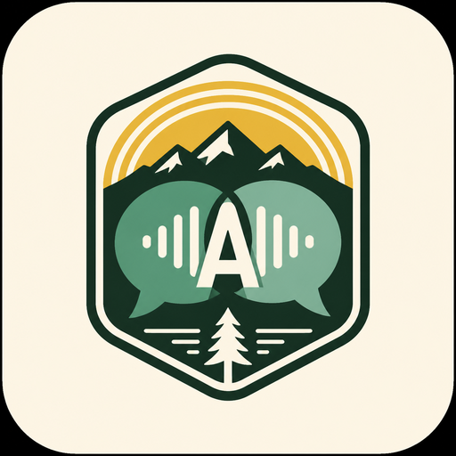
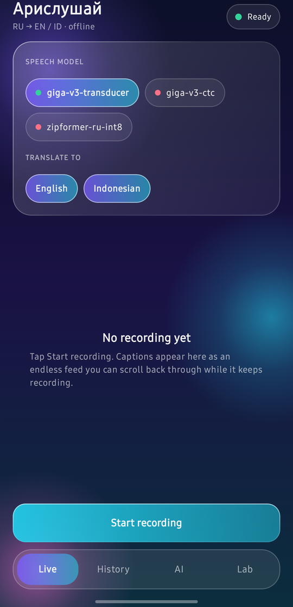
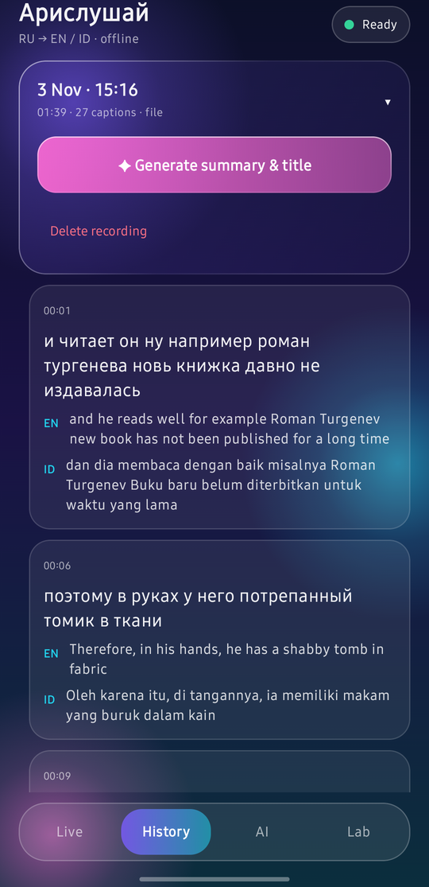
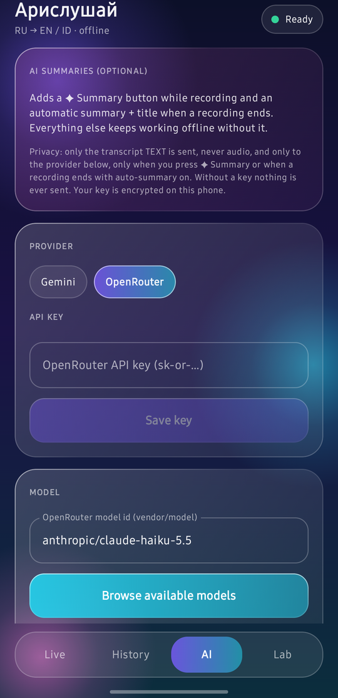
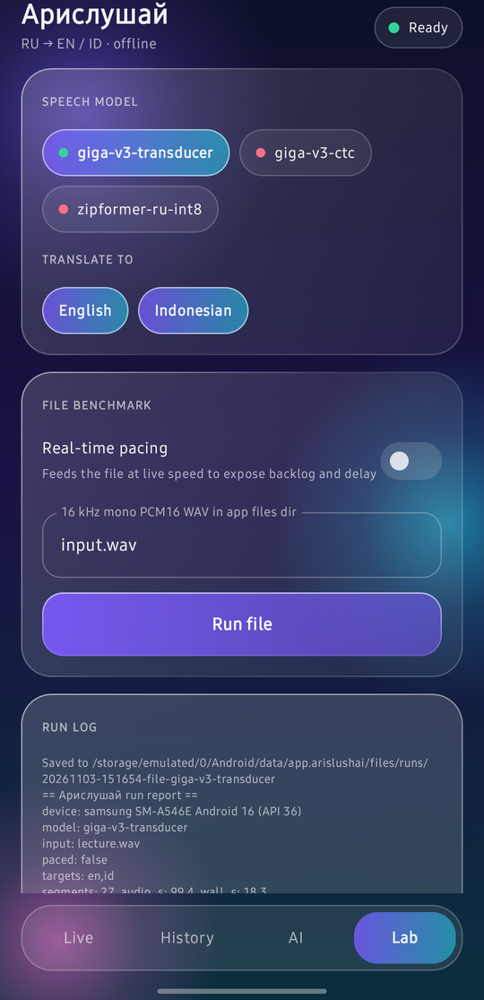
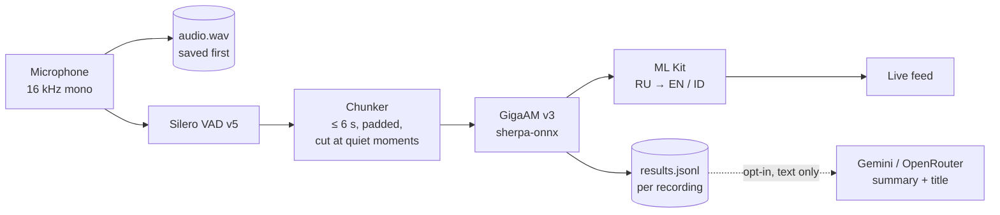

<div align="center">



# Арислушай

**Offline Russian lecture captions with English and Indonesian translation, on your phone.**

[](https://github.com/Mhmdaris15/Arislushai/actions/workflows/build.yml)
[](https://github.com/Mhmdaris15/Arislushai/releases/latest)
[](LICENSE)
-3DDC84)


</div>

Арислушай ("Aris, listen") helps a student who does not yet follow spoken Russian keep up with lectures and seminars.
It listens through the microphone, shows **Russian captions as they are spoken**, and translates them into **English or
Indonesian**, all on the phone. Audio and transcripts never leave the device unless you opt in to AI summaries.

<div align="center">

| Live | History | AI | Lab |
|:---:|:---:|:---:|:---:|
|  |  |  |  |

</div>

## Features

- **Live captions, offline.** Russian speech recognition with [GigaAM v3](https://github.com/salute-developers/GigaAM) running on-device through [sherpa-onnx](https://github.com/k2-fsa/sherpa-onnx).
- **English and Indonesian translation** on-device with Google ML Kit (Russian to Indonesian pivots through English).
- **Tentative captions.** Dimmed italic text and translation appear for speech still in progress and are replaced by the final caption when the chunk ends.
- **Endless feed.** Scroll back through the whole lecture while it keeps recording; a **↓ Live** button jumps back.
- **History.** Every recording is saved as it happens (a crash loses nothing), shown as an expandable section with its own title and summary. Deleting a recording removes its audio, transcript and summary.
- **Optional AI summaries and titles.** Enter your own Gemini or OpenRouter key; press **✦ Summary** at any time, or let the app summarise when a recording ends. Off until you add a key.
- **Works with the screen locked.** A foreground microphone service plus captions shown over the lock screen keep the app running at full speed.
- **Built-in benchmarks.** Replay a WAV file and get a report of speed, delay, memory, battery and heat.

## How it works



Audio is written to disk before any recognition, so a slow phone creates a visible queue instead of lost audio.

## Measured results

Measured on one **Samsung Galaxy A54 (SM-A546E, Exynos 1380, 7.6 GB RAM, Android 16)** by replaying a single 99-second
Russian lecture recording in real time with the screen locked. This is a small sample, not a benchmark suite.

| Measure | Result |
|---|---|
| Speech decode, per chunk (median / worst) | 0.67 s / 1.0 s for chunks of up to 5.8 s |
| Decode speed vs. audio (speech only) | 0.17× real time |
| Translation, per language per chunk | about 0.2 to 0.5 s |
| Wait until a chunk's first word is shown (median / p95 / worst) | 6.8 s / 7.7 s / 7.8 s |
| Queue depth | never above 2; did not grow |
| Memory | about 450 to 550 MB resident |
| Model load, warm | about 1.9 s |

**Not yet measured:** a 45 to 60 minute sustained run (battery, heat, memory growth), recognition accuracy against a human
transcript, and translation quality beyond spot checks. See [Known limitations](#known-limitations).

Two findings shaped the design:

- **Screen locked means slow.** With the screen locked and no visible activity, Android put the app in a restricted CPU group
  and decoding ran 5 to 8 times slower. Showing the captions over the lock screen keeps it at full speed.
- **Delay is chunk length, not compute.** The VAD alone produced 14 to 18 second chunks, and a caption cannot appear before
  its chunk ends. The app now cuts chunks itself after about 6 seconds.

The model comparison behind the default choice is in [MODELS.md](MODELS.md).

## Install

### From a release (easiest)

1. Download `arislushai-1.0.1.apk` from the [latest release](https://github.com/Mhmdaris15/Arislushai/releases/latest) and allow installing from your browser or file manager.
2. Open the app once, then install the speech models from a PC (below). The app cannot recognise speech without them.

### Install the models (about 220 MB, once)

On a Windows PC with the phone connected over USB (USB debugging on):

```powershell
git clone git@github.com:Mhmdaris15/Arislushai.git
cd Arislushai
.\scripts\push-models.ps1                        # GigaAM v3 transducer + VAD
.\scripts\push-models.ps1 -Models giga-v3-ctc    # or another model
```

The first time you record with English or Indonesian translation turned on, the phone needs internet for a moment to
download the ML Kit translation models (about 30 MB per language). After that everything works in airplane mode.

## Build from source

Requirements: Android Studio (for its bundled JDK 21 and SDK manager), Android SDK platform 37 and build-tools 36, a phone with USB debugging.

```powershell
.\scripts\fetch-deps.ps1                       # downloads the sherpa-onnx library and verifies its SHA-256
$env:JAVA_HOME = 'C:\Program Files\Android\Android Studio\jbr'
.\gradlew.bat :app:testDebugUnitTest :app:assembleDebug
adb install -r app\build\outputs\apk\debug\app-debug.apk
```

A signed release APK needs your own keystore: see the comments at the top of [`app/build.gradle.kts`](app/build.gradle.kts).
Without one, `assembleRelease` produces an unsigned APK.

## Using it

1. **Live** tab: choose a speech model and the translation languages, then **Start recording**. Allow the microphone and notification permissions.
2. Read captions as they appear. Scroll up to re-read; the feed stops following until you tap **↓ Live**.
3. Press **✦ Summary** (once a key is saved) for a running summary of what has happened so far.
4. **Stop recording.** If auto-summary is on and you saved a key, the recording is summarised and titled.
5. **History** tab: open a recording, read it back, generate a summary for older ones, or delete it.

## Privacy

- Audio is recorded and recognised on the phone and stays in the app's private storage.
- Translation is on-device after the one-time model download.
- AI summaries are **opt-in**. Nothing is sent without an API key. When you press ✦ Summary, or a recording ends with auto-summary on, the **transcript text only** (never audio) is sent to the provider you chose. The key is encrypted with an Android Keystore key and sent only in a request header.
- Only record where recording is permitted.

## Project layout

```
app/                       Android app (Kotlin, Jetpack Compose)
  src/main/kotlin/app/arislushai/
    Pipeline.kt            VAD → chunker → recognizer → translation, tentative captions
    LiveService.kt         microphone foreground service, wake lock, end-of-recording summary
    BenchService.kt        file benchmark in a foreground service
    Models.kt, Translation.kt, Wav.kt
    History.kt, Reporting.kt, FileBenchmark.kt
    Llm.kt, AiScreen.kt    optional summaries (Gemini / OpenRouter), key storage
    Screens.kt, Glass.kt, MainActivity.kt   glassmorphism UI
  src/test/                unit tests (summary parser)
scripts/                   fetch-deps.ps1, push-models.ps1
docs/                      PRODUCT_BRIEF.md (original requirements), assets
MODELS.md                  models, licenses, comparison
CHANGELOG.md
```

The original product brief and milestone plan are kept in [`docs/PRODUCT_BRIEF.md`](docs/PRODUCT_BRIEF.md).

## Known limitations

- Android (arm64) only. iOS is under evaluation with Flutter; building for iPhone also needs a Mac.
- Speech models are installed from a PC; there is no in-app download yet.
- Recognition makes mistakes on rare words, and ML Kit translates slang literally (for example «блин» became "pancake").
- Cutting a long sentence every 6 seconds can split it, which hurts translation of the pieces.
- **AI summaries:** the owner confirmed on a real phone that `gemini-3.1-flash-lite` summarises a live transcript (the default since 1.0.1). Summary quality has not been rated, and OpenRouter has not been tried. Larger Gemini models returned `503 high demand` during testing. Requests are retried up to 3 times on 429 and 5xx errors. Model names go stale: `gemini-2.5-flash` already answers 404 for new keys. Use **Browse available models** and **Test connection** if a default stops working.
- Pressing Back on a tab other than Live closes the app.

## Roadmap

- Measure a sustained 45 to 60 minute lecture (battery, heat, memory) and accuracy against a human transcript.
- Streaming preview model (a small streaming Vosk model reaches first text in about 0.7 s) combined with GigaAM for final text.
- In-app model download with progress; Room database; transcript export (TXT and JSON); recovery of interrupted recordings.
- iPhone and Windows through Flutter (the sherpa-onnx and ML Kit plugins both support iOS).

## Acknowledgements

[sherpa-onnx](https://github.com/k2-fsa/sherpa-onnx) (Apache-2.0), [GigaAM](https://github.com/salute-developers/GigaAM) (MIT), [Silero VAD](https://github.com/snakers4/silero-vad) (MIT), [Google ML Kit](https://developers.google.com/ml-kit), Jetpack Compose.

## License

Licensed under the [Apache License 2.0](LICENSE). Copyright 2026 Muhammad Aris Septanugroho. See [NOTICE](NOTICE).
Third-party components and the speech models keep their own licenses (see [MODELS.md](MODELS.md)).
